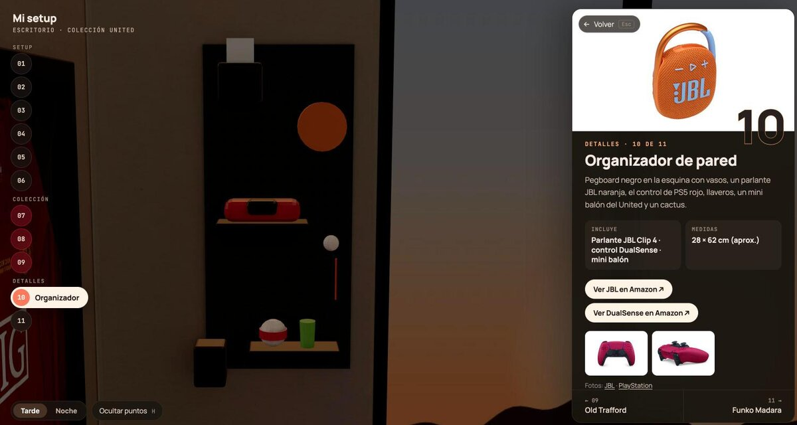
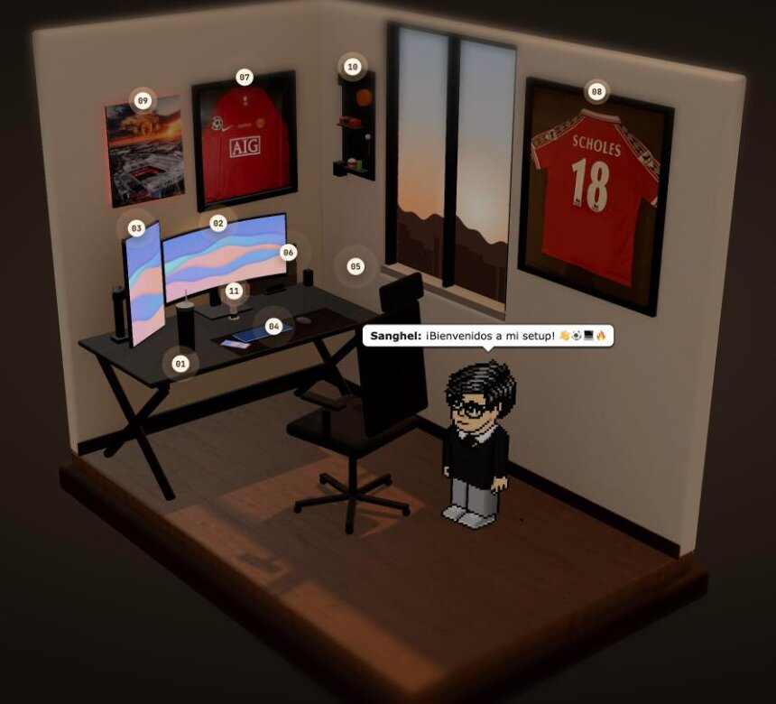
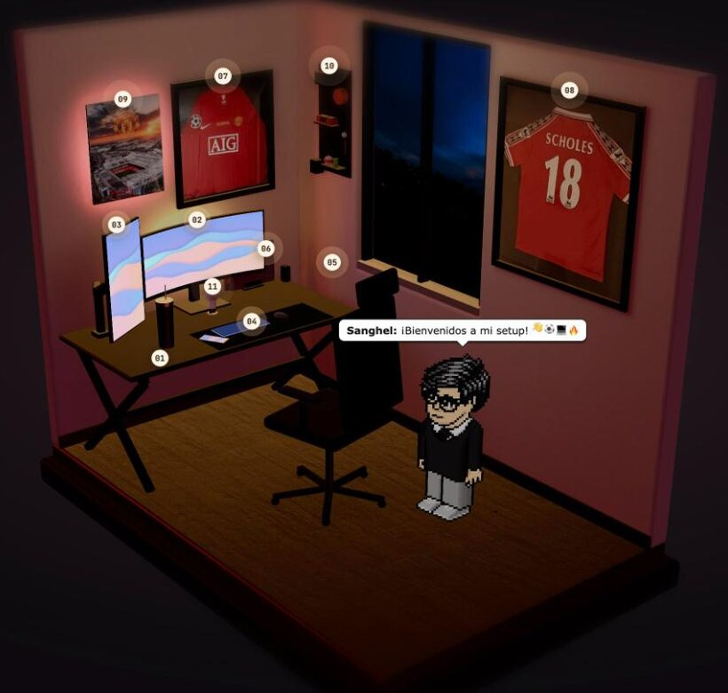

# my-setup-3d

Recreación interactiva de mi habitación y mi setup en 3D, como un **diorama** en dos ambientes: **Tarde**, con el sol entrando por la ventana, y **Noche**, con los LEDs reales del cuarto. Dos paredes, el escritorio con sus dos monitores unidos, las dos portátiles en su dock, la silla, las camisetas enmarcadas, el poster de Old Trafford, el organizador de pared y el Funko de Madara: once objetos numerados. Y, de pie bajo la camiseta de Scholes, el autor como su avatar de Habbo, que saluda con un globo de chat.

Cada objeto tiene un punto numerado y un círculo en el riel de la izquierda: al tocarlo, la cámara vuela hacia él, el resto del cuarto se atenúa y una ficha editorial muestra su número, sus datos y el objeto anterior y el siguiente. En los productos comerciales, la ficha suma las fotos oficiales del fabricante y un botón para verlo en la tienda. El diseño parte de un mock hecho en Claude Design.



| Tarde | Noche |
|---|---|
|  |  |

## Cómo usarlo

| Acción | Escritorio | Celular |
|---|---|---|
| Inspeccionar un objeto (la cámara vuela hacia él) | Click sobre él, sobre su punto o en el riel numerado | Tap (el riel va en una fila arriba) |
| Anterior / siguiente objeto | `←` `→` o los vecinos al pie de la ficha | Vecinos al pie de la ficha |
| Volver | `Esc`, "Volver" o click en el fondo | "Volver" |
| Tarde ⇄ Noche | `N` o el selector de abajo | Selector |
| Ocultar los puntos | `H` o "Ocultar puntos" (abajo) | "Ocultar puntos" |

La cámara no se arrastra ni hace zoom a mano: solo se mueve al elegir un objeto y al volver. Todo se puede usar solo con teclado: `Tab` recorre el riel (cada círculo se despliega con su nombre) y `Enter` inspecciona. En celular la vista general encuadra el cuarto de cerca, aunque los bordes de la base queden fuera. Con *reducir movimiento* activado en el sistema, la entrada es directa y el LED y el polvo quedan quietos.

## Correrlo en local

```bash
npm install
npm run dev        # http://localhost:5173
npm test           # Vitest (escena, catálogo, estado, cámara, interfaz)
npm run build      # build de producción en dist/
```

El modelo ya optimizado (`public/models/room.glb`) y la luz horneada de los dos ambientes (`lightmap-tarde.webp`, `lightmap-noche.webp`) están en el repo: **no hace falta Blender** para correr el sitio.

## Cómo se construye el cuarto

El cuarto no se modela a mano: lo genera **código Python que controla Blender** a partir de medidas reales (`blender/measurements.json`, en centímetros).

```
measurements.json + texturas
        │
        ▼
blender/scripts/build_room.py   (Blender sin interfaz: geometría, materiales PBR, sol y LEDs)
        │  hornea la luz con Cycles dos veces (Tarde y Noche) sobre la misma UV2 + denoise OIDN
        ▼
blender/out/room.raw.glb        (~16 MB, intermedio, no se versiona)
        │  gltf-transform: meshopt + WebP
        ▼
public/models/room.glb (~3 MB) + lightmap-tarde.webp + lightmap-noche.webp (~170 KB c/u)
        │
        ▼
React Three Fiber: los dos lightmaps se mezclan en el shader (onBeforeCompile),
bloom, AgX, cámara con easing, puntos de interés e interfaz
```

| Script | Qué hace |
|---|---|
| `npm run assets` | Construye, hornea los dos ambientes (rápido, 1024 px, ~1 min) y optimiza. Requiere **Blender 5.2** en el `PATH` |
| `npm run assets:final` | Igual, con el horneado de calidad final (2048 px, 1024 muestras, ~8 min) |
| `npm run assets:preview` | Render de Blender para comparar con la web (`-- --ambience tarde\|noche`) |
| `npm run textures:sky` | Genera el cielo de atardecer de la ventana (por código, sin fotos) |
| `npm run textures:wallpapers` | Genera los fondos de las dos pantallas (ondas de colores, por código) |
| `npm run textures:scholes` | Quita de la camiseta de Scholes el reflejo de quien tomó la foto (separación de frecuencias) |
| `npm run textures:avatar` | Prepara el avatar de Habbo del autor (recorte y ampliación sin suavizar) |
| `npm run textures` | Descarga y tiñe las texturas de Poly Haven |
| `npm run textures:photos` | Corrige la perspectiva de las fotos (los originales no están en el repo) |
| `npm run products:photos` | Convierte las fotos oficiales de producto a WebP sin metadatos (`blender/textures/products.json`; los originales no están en el repo) |
| `npm run textures:screens:code` | Pantallas con código real de este repo (fuera del pipeline: ahora llevan los fondos del mock) |

## Stack

- **Vite + React 19 + TypeScript**
- **three.js** vía **React Three Fiber** y **drei** (CameraControls, Environment, useProgress)
- **postprocessing**: bloom y tone mapping AgX
- **zustand** para el estado (vista general ↔ inspección)
- **Blender 5.2** (bpy, sin interfaz) + **Cycles** para la luz horneada
- **gltf-transform** para optimizar el modelo
- **Vitest + Testing Library**; **oxlint**; CI en GitHub Actions

## Rendimiento

- **~3,4 MB** transferidos en la primera visita (modelo, dos lightmaps, código y fuentes). Las fotos de producto (~430 KB en total) **no** cuentan: se descargan al abrir el panel de cada objeto.
- **~120 draw calls** por cuadro con los diez objetos y el post-procesado; ~68 fps de tarde, ~83 de noche y ~78 inspeccionando, en un portátil (build de producción).
- Sin luces en tiempo real: toda la luz difusa está horneada. Lo que se mueve (el LED que respira, el polvo) va encima.

## Créditos y licencias

| Recurso | Origen | Licencia |
|---|---|---|
| Piso laminado (`laminate_floor_02`, `laminate_floor_03`) y pared (`beige_wall_001`) | [Poly Haven](https://polyhaven.com) | CC0 |
| Poster y camiseta 2008 | Fotos propias, procesadas | Del autor |
| Camiseta Scholes 18 | Textura del mock (foto propia), sin el reflejo del fotógrafo (`scripts/clean-scholes.mjs`) | Del autor |
| Muñeco del autor | Su avatar de [Habbo Hotel](https://www.habbo.com), generado con el avatar imager oficial | Arte de Habbo © Sulake; uso personal |
| Cabeceras de las fichas sin fotos | Capturas de la propia escena (`public/headers/`) | — |
| Fondos de las pantallas | Generados por código (`scripts/render-wallpapers.mjs`) | — |
| Desk mat y tablero del organizador | Generados por código | — |
| Fotos de producto del panel | Oficiales de [Xiaomi](https://www.mi.com/global/product/xiaomi-curved-gaming-monitor-g34wqi/), [Gigabyte](https://www.gigabyte.com/Monitor/GS27FA), [Apple](https://www.apple.com/macbook-pro/), [ASUS](https://www.asus.com) (TUF de referencia), [Logitech](https://www.logitech.com), [JBL](https://global.jbl.com), [PlayStation](https://www.playstation.com), [Funko](https://funko.com) y [Mublex](https://www.mublex.com) (silla de referencia) | De sus fabricantes; se acreditan con enlace en cada panel |
| Cielo de atardecer de la ventana | Generado por código (`scripts/render-sky.mjs`) | — |
| Tipografías Manrope y JetBrains Mono | [Google Fonts](https://fonts.google.com) | SIL Open Font License |
| Diseño de la interfaz | Mock propio hecho en Claude Design | — |
| Favicon | Diseño propio (mini diorama, `public/favicon.svg`) | — |

Las marcas y escudos que aparecen en las camisetas, el poster y los productos pertenecen a sus dueños. Los botones "Ver en Amazon" / "Ver en Mublex" son enlaces normales, **sin afiliado**. Es un proyecto personal sin fines comerciales.

## Bitácora

Este proyecto se hizo para aprender: cada grupo de tareas tiene una nota con los conceptos nuevos (Blender como código, glTF, PBR, luz horneada, raycasting, cámaras, accesibilidad, deploy…) en mi bóveda de Obsidian, y las especificaciones viven en [OpenSpec](https://github.com/Fission-AI/OpenSpec).
