<!-- markdownlint-disable-next-line MD041 -->
<a id="top"></a>

<div align="center">



<h1>My Setup 3D</h1>

<p><strong>My room and desk setup as an interactive 3D diorama — generated in Blender from real measurements.</strong></p>

<p>
<a href="https://my-setup-3d.vercel.app"></a>
<a href="https://github.com/Sanghel/my-setup-3d/actions/workflows/ci.yml"></a>


</p>

<p>
<a href="https://my-setup-3d.vercel.app"><strong>Live demo</strong></a> &bull;
<a href="#how-to-use-it"><strong>How to use it</strong></a> &bull;
<a href="#how-the-room-is-built"><strong>How it's built</strong></a> &bull;
<a href="#quick-start"><strong>Quick start</strong></a>
</p>

<br/>

<p>
A recreation of my room as a <strong>diorama</strong> in two moods: <strong>Afternoon</strong>, with sunlight coming
through the window, and <strong>Night</strong>, lit by the room's real LEDs. Two walls, the desk with its two joined
monitors, both laptops on their dock, the chair, the framed shirts, the Old Trafford poster, the wall organizer
and the Madara Funko — eleven numbered objects. And standing under the Scholes shirt, me as my Habbo avatar,
waving with a chat bubble.
</p>

<br/>


<table>
<tr>
<td width="50%" align="center"><br/><sub><strong>Afternoon</strong></sub></td>
<td width="50%" align="center"><br/><sub><strong>Night</strong></sub></td>
</tr>
</table>

<sub><strong>BUILT WITH</strong></sub>

<br/>


<br/><br/>

</div>

<div align="center"></div>

## How to use it

Every object has a numbered dot and a circle on the left rail: select it and the camera flies to it, the rest of
the room dims, and an editorial card shows its number, its details, and the previous and next objects. For
commercial products the card adds the manufacturer's official photos and a button to see it in the store.

| Action | Desktop | Mobile |
|---|---|---|
| Inspect an object (camera flies to it) | Click it, its dot or the numbered rail | Tap (the rail sits in a row on top) |
| Previous / next object | `←` `→` or the neighbors at the bottom of the card | Neighbors at the bottom of the card |
| Go back | `Esc`, "Volver" or click the background | "Volver" |
| Afternoon ⇄ Night (*Tarde* ⇄ *Noche*) | `N` or the switch at the bottom | Switch |
| Hide the dots | `H` or "Ocultar puntos" | "Ocultar puntos" |

The camera can't be dragged or zoomed by hand: it only moves when you pick an object and when you go back.
Everything works from the keyboard — `Tab` walks the rail (each circle expands with its name) and `Enter`
inspects. With *reduce motion* turned on, the intro is instant and the LED and dust stay still.

> The interface is in Spanish; button labels are quoted as they appear on screen.

<div align="center"></div>

## How the room is built

The room isn't modeled by hand: it's generated by **Python code driving Blender**, from real measurements
(`blender/measurements.json`, in centimeters).

```
measurements.json + textures
        │
        ▼
blender/scripts/build_room.py   (headless Blender: geometry, PBR materials, sun and LEDs)
        │  bakes the light with Cycles twice (Afternoon and Night) onto the same UV2 + OIDN denoise
        ▼
blender/out/room.raw.glb        (~16 MB, intermediate, not versioned)
        │  gltf-transform: meshopt + WebP
        ▼
public/models/room.glb (~3 MB) + lightmap-tarde.webp + lightmap-noche.webp (~170 KB each)
        │
        ▼
React Three Fiber: both lightmaps blended in the shader (onBeforeCompile),
bloom, AgX, eased camera, points of interest and UI
```

<details>
<summary><strong>Asset scripts</strong></summary>

| Script | What it does |
|---|---|
| `npm run assets` | Builds, bakes both moods (fast, 1024 px, ~1 min) and optimizes. Requires **Blender 5.2** on the `PATH` |
| `npm run assets:final` | Same, with the final-quality bake (2048 px, 1024 samples, ~8 min) |
| `npm run assets:preview` | Blender render to compare against the web (`-- --ambience tarde\|noche`) |
| `npm run textures:sky` | Generates the sunset sky outside the window (procedural, no photos) |
| `npm run textures:wallpapers` | Generates the wallpapers of both screens (procedural color waves) |
| `npm run textures:scholes` | Removes the photographer's reflection from the Scholes shirt (frequency separation) |
| `npm run textures:avatar` | Prepares my Habbo avatar (crop and nearest-neighbor upscale) |
| `npm run textures` | Downloads and tints the Poly Haven textures |
| `npm run textures:photos` | Corrects the perspective of the photos (originals aren't in the repo) |
| `npm run products:photos` | Converts the official product photos to metadata-free WebP (`blender/textures/products.json`; originals aren't in the repo) |
| `npm run textures:screens:code` | Screens showing real code from this repo (outside the pipeline: they now use the mock's wallpapers) |

</details>

<div align="center"></div>

## Tech stack

| Layer | Technology |
|---|---|
| App |    |
| 3D |  via React Three Fiber and drei (CameraControls, Environment, useProgress) |
| Post-processing | `postprocessing`: bloom and AgX tone mapping |
| State |  overview ↔ inspection |
| Content pipeline |  (bpy, headless) + Cycles for baked lighting · `gltf-transform` to optimize the model |
| Quality |  + Testing Library · oxlint · CI on GitHub Actions |
| Hosting |  |

### Performance

- **~3.4 MB** transferred on the first visit (model, both lightmaps, code and fonts). Product photos (~430 KB
  total) **don't** count: they load when you open each object's card.
- **~120 draw calls** per frame with all objects and post-processing; ~68 fps in the afternoon, ~83 at night and
  ~78 while inspecting, on a laptop (production build).
- No real-time lights: all diffuse light is baked. What moves (the breathing LED, the dust) is layered on top.

<div align="center"></div>

## Quick start

```bash
npm install
npm run dev        # http://localhost:5173
npm test           # Vitest (scene, catalog, state, camera, UI)
npm run build      # production build in dist/
```

The optimized model (`public/models/room.glb`) and the baked light for both moods (`lightmap-tarde.webp`,
`lightmap-noche.webp`) are committed: **you don't need Blender** to run the site.

<div align="center"></div>

## Credits & licenses

| Asset | Source | License |
|---|---|---|
| Laminate floor (`laminate_floor_02`, `laminate_floor_03`) and wall (`beige_wall_001`) | [Poly Haven](https://polyhaven.com) | CC0 |
| Poster and 2008 shirt | Own photos, processed | The author's |
| Scholes 18 shirt | Texture from the mock (own photo), without the photographer's reflection (`scripts/clean-scholes.mjs`) | The author's |
| My figure | My [Habbo Hotel](https://www.habbo.com) avatar, generated with the official avatar imager | Habbo art © Sulake; personal use |
| Headers of cards without photos | Captures of the scene itself (`public/headers/`) | — |
| Screen wallpapers | Generated by code (`scripts/render-wallpapers.mjs`) | — |
| Desk mat and organizer board | Generated by code | — |
| Product photos in the card | Official, from [Xiaomi](https://www.mi.com/global/product/xiaomi-curved-gaming-monitor-g34wqi/), [Gigabyte](https://www.gigabyte.com/Monitor/GS27FA), [Apple](https://www.apple.com/macbook-pro/), [ASUS](https://www.asus.com) (reference TUF), [Logitech](https://www.logitech.com), [JBL](https://global.jbl.com), [PlayStation](https://www.playstation.com), [Funko](https://funko.com) and [Mublex](https://www.mublex.com) (reference chair) | Their manufacturers'; credited with a link on each card |
| Sunset sky outside the window | Generated by code (`scripts/render-sky.mjs`) | — |
| Manrope and JetBrains Mono fonts | [Google Fonts](https://fonts.google.com) | SIL Open Font License |
| UI design | Own mock made in Claude Design | — |
| Favicon | Own design (mini diorama, `public/favicon.svg`) | — |

The brands and crests on the shirts, the poster and the products belong to their owners. The "Ver en Amazon" /
"Ver en Mublex" buttons are plain links, **no affiliate**. This is a personal, non-commercial project.

### Learning log

This project was built to learn: each task group has a note with the new concepts (Blender as code, glTF, PBR,
baked lighting, raycasting, cameras, accessibility, deploy…) in my Obsidian vault.

<div align="center">

<sub>Crafted by <a href="https://github.com/Sanghel"><strong>Sanghel González</strong></a> · <a href="https://sanghel-portfolio.vercel.app">Portfolio</a></sub>

<br/>

<a href="#top">↑ Back to top</a>

</div>
